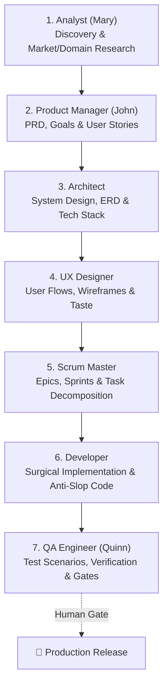

# 🚀 BMAD Method: Agile AI-Driven Software Engineering

The **BMAD Method** (*Breakthrough Method for Agile AI-Driven Development* / *Build More Architect Dreams*) is an agentic engineering framework designed to eliminate chaotic "vibe coding" and replace it with the rigorous discipline of an elite software engineering team.

---

## 🎭 1. The Multi-Role Persona Spectrum

Instead of an undifferentiated assistant making ad-hoc assumptions, BMAD breaks complex development into specialized cognitive personas:

1.  **Analyst:** Uncovers underlying business context, competitive dynamics, and domain models.
2.  **Product Manager (PM):** Defines the *"WHY"*, writes Product Requirements Documents (PRDs), and outlines user journeys.
3.  **Architect:** Specifies the technical architecture, data schemas, API contracts, and trade-offs.
4.  **UX Designer:** Ensures layout harmony, bento compositions, and modern design taste.
5.  **Scrum Master:** Converts PRD and Architecture into phased, atomic Epics and Stories.
6.  **Developer:** Writes surgical, production-grade, anti-slop code according to the specs.
7.  **QA Engineer:** Validates edge cases, executes tests, and verifies acceptance criteria.

---

## ⚡ 2. Right-Sized Process (T-Shirt Sizing)

BMAD dynamically scales process rigor based on project size:

| Scope | Phases Activated | Artifacts Generated |
| :--- | :--- | :--- |
| **Small (Bug Fix / Polish)** | Dev + QA | Direct code fix + verification check |
| **Medium (Single Feature)** | PM + Architect + Dev + QA | Mini-Spec / RFC + Code + Tests |
| **Large (System / Major Initiative)** | Full Spectrum (Analyst ➔ QA) | PRD + Architecture Doc + Epics + Full Suite |

---

## 📦 3. Durable Artifact Preservation

The core failure of raw prompt engineering is losing context across sessions. BMAD mandates writing durable artifacts to repository files:

*   `docs/prd/`: Product Requirements Documents
*   `docs/architecture/`: System Architecture and Sequence Diagrams
*   `docs/adr/`: Architecture Decision Records
*   `docs/qa/`: Test Plans and Acceptance Matrices

---

## 🚪 4. Human-in-the-Loop Review Gates

At critical transition points, the agent pauses to request explicit human confirmation:
*   **Gate 1 (Post-PRD / Scope):** Confirm business goals, user stories, and non-goals before system design.
*   **Gate 2 (Post-Architecture):** Confirm database schema changes and API contracts before coding.
*   **Gate 3 (Post-Implementation):** Review QA validation results before merging or packaging builds.

---

## 📚 Supporting References
*   [BMAD Phase-by-Phase Execution Guide](./references/phase-guide.md)
*   [BMAD Multi-Role Prompt Templates](./references/role-prompts.md)
