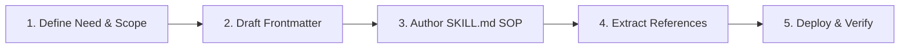

# 🛠️ Skill Creator: Meta-Architecture & Best Practices

This skill guides the design, construction, testing, and deployment of **Antigravity Skills**. It ensures that every custom skill created is high-signal, token-efficient, robustly structured, and easily discovered by the agent.

---

## 📐 1. Directory Structure Standard

Every skill must be packaged as an isolated folder:

```text
skills/<skill-name>/
├── SKILL.md            # Required: Main entry point with frontmatter & high-level runbook
├── references/         # Optional: Deep documentation, API manuals, checklists (loaded on-demand)
├── scripts/            # Optional: Executable automation scripts (.sh, .ps1, .py, .php)
├── examples/           # Optional: Golden reference inputs/outputs or code templates
└── resources/          # Optional: Static assets, schemas, configs, or binaries
```

---

## 🏷️ 2. Frontmatter Engineering (Activation Triggers)

The YAML frontmatter of `SKILL.md` is the **only part** injected into the system prompt initially. Therefore, its quality determines whether the skill is activated accurately:

```yaml
---
name: skill-name-kebab-case
description: >-
  Describe what the skill does AND explicitly when the agent should activate it.
  Use third-person imperative.
  Format: "Action verb + core domain + activation triggers + use-case scenarios."
---
```

### Writing Effective Descriptions:
*   ✅ **Good:** `"Apply world-class design taste, aesthetic craftsmanship, and micro-interaction polish to frontend UI/UX development. Use whenever designing, styling, or refining UI components, layouts, pages, or user experiences."`
*   ❌ **Bad:** `"Helps with CSS."` (Too vague, weak trigger matching).
*   ❌ **Bad:** `"This skill contains all the knowledge about Vue.js, Tailwind, React, and how to write good code."` (Too broad, dilutes routing).

---

## ⚡ 3. The Progressive Disclosure Pattern

To prevent blowing the 200k/1M context window:
1.  **Keep `SKILL.md` Lean (< 300 lines / ~12 KB):**
    *   Focus on core workflows, SOPs, and decision trees.
    *   Avoid dumping raw API documentation or encyclopedic guides in the main file.
2.  **Move In-Depth Content to `references/`:**
    *   Link to reference files using standard markdown links:
        `* [Detailed API Specifications](./references/api-specs.md)`
    *   The agent will read the reference file only when working on a specific subtask that requires it.
3.  **Encapsulate Scripts in `scripts/`:**
    *   Bundle repetitive command sequences into scripts instead of making the agent execute 10 separate shell commands.

---

## 🔄 4. The 5-Step Skill Creation Lifecycle



1.  **Define Need & Scope:** Identify the specialized capability, repeatable workflow, or quality standard needed.
2.  **Draft Frontmatter:** Write an intentional `name` and high-precision `description`.
3.  **Author `SKILL.md` Runbook:**
    *   Core principles & mindset.
    *   Step-by-step Standard Operating Procedures (SOP).
    *   Clear validation criteria (how the agent knows the task succeeded).
4.  **Extract References & Tools:** Place code templates, checklists, or recipes into `references/`.
5.  **Deploy & Verify:**
    *   Deploy to Global (`~/.gemini/config/skills/<name>/`) or Workspace (`.agents/skills/<name>/`).
    *   Verify discovery and test activation with a sample prompt.

---

## 🚫 5. Anti-Patterns to Avoid

*   ❌ **Encyclopedic Bloat:** Storing entire framework documentations inside `SKILL.md`.
*   ❌ **Generalist Re-Instruction:** Telling the agent basic programming facts it already knows (e.g. "PHP variables start with $"). Only teach specialized, project-specific, or high-standard protocols.
*   ❌ **Missing Validation Steps:** Omitting instructions on how the agent should verify its own work.

---

## 📚 Supporting References
*   [Skill Boilerplate Template](./references/template.md)
*   [Skill Quality Checklist](./references/validation-checklist.md)
