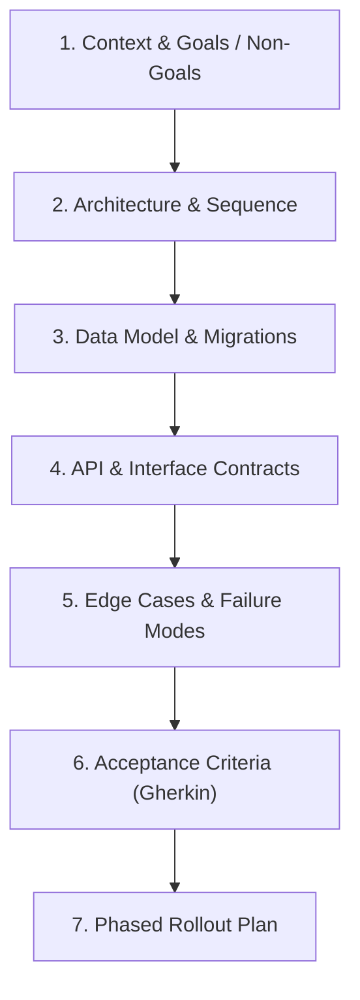

# 📑 Spec-Kit: Specification-Driven Development (SDD)

This skill enforces the **Specification-Driven Development** methodology. It provides frameworks, templates, and mental models to design robust technical specifications, API contracts, and Architecture Decision Records (ADRs) before writing production code.

> **Motto:** *"Measure twice, cut once."* Writing an explicit specification eliminates rework, ambiguous edge cases, and architectural drift.

---

## 🎯 1. When to Write a Spec

Always author a technical specification when:
1.  **Non-Trivial Feature:** The task spans multiple database tables, APIs, or user journeys.
2.  **Architectural Shift:** Changing storage engines, introducing queues, modifying authentication, or refactoring core modules.
3.  **Cross-Cutting Concerns:** Security models, payment gateways, export pipelines, or third-party integrations.
4.  **Ambiguous Requirements:** Clarifying unclear business logic through explicit Acceptance Criteria before writing code.

---

## 🏗️ 2. Anatomy of a World-Class Technical Spec

Every technical specification produced under `spec-kit` must contain these 7 sections:

1.  **Context & Goals / Non-Goals:**
    *   State the problem clearly.
    *   Explicitly define **Goals** (what we MUST achieve) and **Non-Goals** (what is deliberately out of scope to prevent scope creep).
2.  **Architecture & Data Flow:**
    *   High-level component interactions or Mermaid sequence diagrams.
    *   Data lifecycle from ingestion to persistence.
3.  **Data Model & Schema Migrations:**
    *   Table definitions, column types, nullability, unique keys, foreign keys, and indexes.
    *   Data migration strategy (zero downtime, backwards compatibility).
4.  **Interface & API Contracts:**
    *   Endpoints, HTTP methods, headers, payload request schemas, response schemas, and HTTP status codes.
5.  **Edge Cases & Failure Modes:**
    *   Network drops, duplicate requests, timeouts, concurrency locks, permission denials, and rate limits.
6.  **Acceptance Criteria (Given / When / Then):**
    *   Testable scenarios written in unambiguous Gherkin format.
7.  **Implementation Phasing & Rollback Plan:**
    *   Step-by-step task breakdown with verification gates.

---

## 📝 3. Architecture Decision Records (ADR) Protocol

When choosing between technical trade-offs (e.g. SQLite vs PostgreSQL, Queue vs Synchronous, REST vs WebSocket):
*   Do not leave decisions undocumented in chat history.
*   Document the choice in a lightweight **ADR** (`docs/adr/XXXX-title.md`) containing:
    *   **Context:** Why the decision was needed.
    *   **Decision:** The path chosen.
    *   **Consequences:** Trade-offs, drawbacks, and mitigation strategies accepted.

---

## 🔍 4. Spec Review Protocol

Before declaring a specification ready for implementation:
1.  **Feasibility Check:** Can this be built within the constraints of the existing tech stack?
2.  **Security Review:** Are all inputs sanitized? Are authorization gates enforced per record?
3.  **Data Integrity:** Are multi-step mutations transactional (`DB::transaction`) and idempotent?
4.  **Testability:** Can every acceptance criterion be validated with an automated test or clear manual check?

---

## 📚 Supporting References & Templates
*   [Technical Spec / RFC Template](./references/tech-spec-template.md)
*   [Architecture Decision Record (ADR) Template](./references/adr-template.md)
*   [Acceptance Criteria & Gherkin Guide](./references/acceptance-criteria.md)
