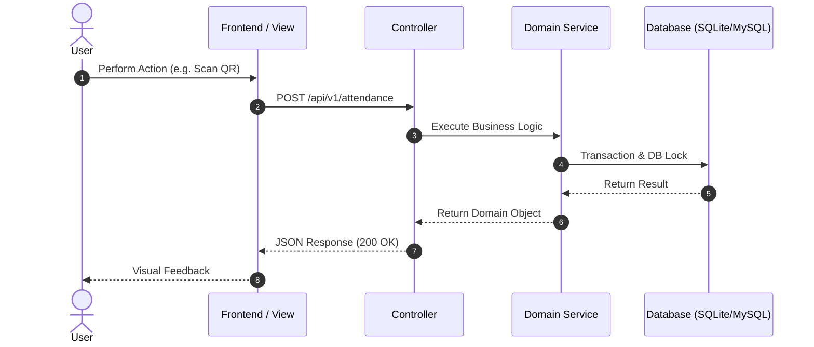

# Technical Design Document (RFC) Template

> **Feature / System:** [Feature Name]  
> **Author:** [Author Name / Senior Dev]  
> **Status:** Draft / In Review / Approved / Implemented  
> **Date:** [YYYY-MM-DD]  

---

## 1. Summary & Problem Statement
*   **Background:** [Why is this work necessary? What pain point does it solve?]
*   **Goals:**
    *   [Goal 1]
    *   [Goal 2]
*   **Non-Goals:**
    *   [Explicitly out of scope item 1]
    *   [Explicitly out of scope item 2]

---

## 2. Architecture & Design

### 2.1 Component Interaction Diagram


---

## 3. Data Model & Schema Changes

### 3.1 Migration Specification
*   **Table Name:** `example_table`
*   **Fields:**
    *   `id`: `BIGINT UNSIGNED AUTO_INCREMENT PRIMARY KEY`
    *   `name`: `VARCHAR(255) NOT NULL`
    *   `status`: `ENUM('active', 'inactive') DEFAULT 'active'`
    *   `created_at`, `updated_at`: `TIMESTAMP`
*   **Indexes:**
    *   `INDEX idx_status (status)`
    *   `UNIQUE uk_name (name)`

---

## 4. API Specification & Contracts

### `POST /api/v1/resource`
*   **Description:** Creates a new resource.
*   **Headers:** `Content-Type: application/json`, `X-CSRF-TOKEN: ...`
*   **Request Body:**
    ```json
    {
      "identifier": "EMP-001",
      "action": "check_in"
    }
    ```
*   **Success Response (`200 OK` / `201 Created`):**
    ```json
    {
      "success": true,
      "message": "Resource created successfully",
      "data": {
        "id": 1,
        "identifier": "EMP-001"
      }
    }
    ```
*   **Error Responses:**
    *   `422 Unprocessable Content`: Validation failure
    *   `403 Forbidden`: Unauthorized user
    *   `409 Conflict`: Duplicate entry or race condition

---

## 5. Security & Edge Cases
*   **Input Sanitization:** [How input is validated and sanitized]
*   **Concurrency & Race Conditions:** [How DB locks or transactions prevent double submission]
*   **Network & Timeout Handling:** [Retries, idempotency keys, offline caching]

---

## 6. Acceptance Criteria (BDD / Gherkin)

```gherkin
Scenario: Successful action
  Given the user is authenticated as an admin
  When they submit valid parameters
  Then the record should be saved in the database
  And a success alert should be displayed

Scenario: Duplicate submission prevented
  Given a record with the same identifier already exists
  When the user submits the identical request
  Then the system should reject the request with HTTP 422
  And no duplicate record should be inserted
```

---

## 7. Implementation Plan
1. [ ] Step 1: Database Migration & Model Definition
2. [ ] Step 2: Domain Action / Service Class Implementation
3. [ ] Step 3: Controller & Route Setup
4. [ ] Step 4: Frontend View / UI Integration
5. [ ] Step 5: Verification & Automated Test Coverage
